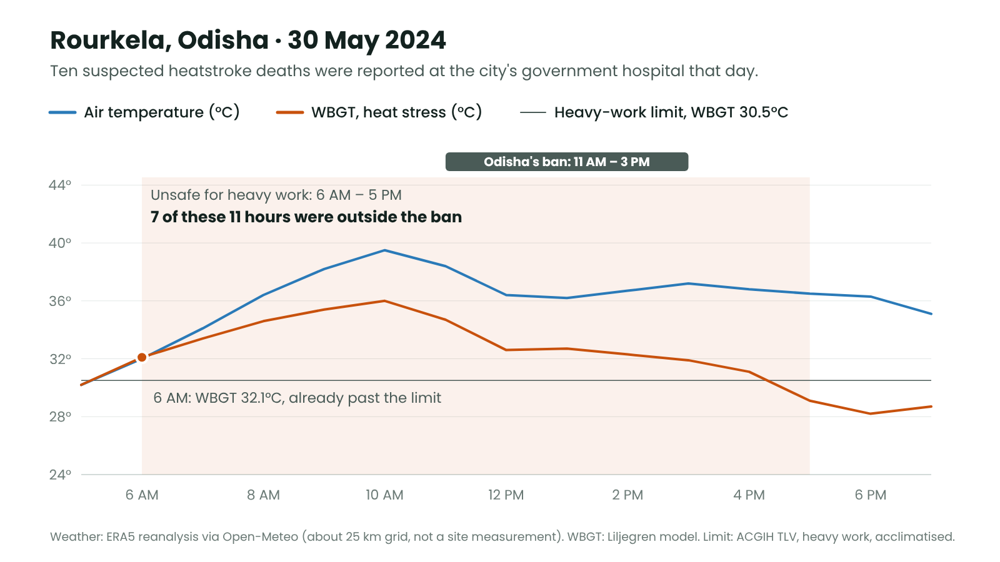

# The thermometer points at the wrong hour: heat-safe shifts for India's outdoor workers on AWS

*How I built Chhaon, a Hindi-first serverless app that turns a site's forecast into heat-safe shifts, calls every break on a speaker, and guides heatstroke first aid.*


## Nine in the morning

Picture a building site in Howrah on an October morning. The slab has to be poured before the afternoon. The supervisor, the *munshi*, glances at the weather on his phone: 29°C. Mild, for Bengal. The crew keeps carrying.

What the phone doesn't show is that the air is wet and almost still, and the sun is already strong. The heat stress on his crew, measured as WBGT, is 33.6°C. For heavy work like a concrete pour, the occupational screening limit says to stop above 30.5°C. By the number that matters, his crew is past the limit. By the number on his phone, it's a pleasant morning.

This project lives in that gap between the number people see and the number their bodies feel.

Heat already kills people who work outdoors in India. Between March and mid-June 2024, the Health Ministry counted 110 confirmed heatstroke deaths and more than 40,000 suspected cases. The ILO projects that heat stress will cost India 5.8% of its working hours in 2030, with construction hit hardest. The person who decides when a crew rests isn't a safety engineer with a WBGT meter. It's a supervisor with a phone, a deadline, and workers who are paid by the day.

For Environmental Hacks (Heat and Water track), I built **Chhaon** (छाँव, "shade") for that person. This is the story of how, what's under the hood, and what fought back.

## The question that started it

On 30 May 2024, ten people with suspected heatstroke were reported dead at the government hospital in Rourkela, Odisha. That week the state barred its own employees from working outdoors between 11 AM and 3 PM, the hours when the air is hottest. Five deaths from "sunstroke" were reported the same day in Aurangabad city, Bihar ([Business Standard / Reuters](https://www.business-standard.com/india-news/15-succumb-to-suspected-heatstroke-in-bihar-odisha-over-24-hours-124053100673_1.html)).

Before writing a single line of app code, I wanted to answer one question: **was 11 to 3 the right window?**

### The thermometer lies about the time

I replayed the actual weather of that day (ERA5 reanalysis) through a WBGT model, hour by hour.


*Aurangabad, 30 May 2024: the hottest air came five hours after the most dangerous heat.*

In Aurangabad, the air was hottest at 2 PM: 44.7°C. But by WBGT, the most dangerous hour was **9 AM**. The air was 39°C, humid and nearly still, under a strong morning sun, and WBGT was 37.9°C. By 2 PM the air had dried out and the wind had picked up, and WBGT had fallen to 32.4°C. That's still too hot for heavy work, but well past the worst of it.

### The ban covered the wrong hours



*Rourkela, 30 May 2024: seven of the eleven unsafe hours fell outside the ban.*

In Rourkela, heavy work was past the safe limit from **6 AM** and stayed there until 5 PM, eleven hours in all. The 11-to-3 ban covered four of them, so seven dangerous hours fell outside the rule meant to protect people.

These are modelled values from a 25 km weather grid, not site measurements. The pattern is the point: humidity and morning sun can be more dangerous than dry afternoon heat. **The thermometer points at the wrong hour.**

## Why temperature is the wrong number

Heat illness tracks WBGT, the wet bulb globe temperature:

**WBGT = 0.7 × natural wet bulb + 0.2 × black globe + 0.1 × air temperature**

The natural wet bulb captures humidity and wind, which decide how well sweat can cool you. The black globe captures radiant heat from the sun. Air temperature, the only number on most phones, carries just a tenth of the weight.

Occupational limits are written in WBGT. The ACGIH screening table (as published by CCOHS) says how much of each hour a worker can safely work. For heavy work like digging, carrying sacks or a concrete pour:

| Heavy work per hour | WBGT limit, acclimatised | WBGT limit, new to the heat |
|---|---|---|
| 45 min (50–75%) | 27.5°C | 24.0°C |
| 30 min (25–50%) | 29.0°C | 25.5°C |
| 15 min (0–25%) | 30.5°C | 28.0°C |
| Above that | stop | stop |

Above the last row the table gives no screening value at all; ACGIH says that needs detailed analysis or physiological monitoring. Chhaon simply stops that work.

No weather station measures WBGT, because it needs a black globe and a wet wick in the sun. In 2008, Liljegren and colleagues at Argonne National Laboratory published a model that computes it from ordinary weather data: temperature, humidity, wind, solar radiation, pressure and the sun's angle. I ported it to Python and checked it two ways:

- **Against Liljegren's own C implementation**, as packaged in [mdljts/wbgt](https://github.com/mdljts/wbgt): globe, natural wet bulb and WBGT match to within 0.01°C on the same inputs.
- **Against Open-Meteo's own wet-bulb output** for 96 hours of Howrah forecast: a mean difference of −0.05°C, and 0.46°C at worst.

It hasn't been checked against a WBGT meter on a real site yet. That's the first thing on my list.

## Designing for the person, not the dashboard

Before any architecture, I wrote down the constraints, because they drove every decision:

- **The user is a supervisor standing in the sun.** The app is Hindi first, with times said the way people speak ("दोपहर 1 बजे", not "13:00"). It's high contrast, with big buttons, three tabs and no sign-up.
- **Many workers don't read.** So the plan has to be heard: announced on a speaker, and sent as a voice note.
- **The network drops.** The day's plan, its audio and the first-aid steps all have to work offline.
- **Rest costs wages.** A rule that only says "stop" gets ignored by people paid by the day. The plan has to show what work is still possible, and what shade is worth.
- **The AI never makes a safety call.** Every number and every decision comes from tested code.


*The Today screen. Stopped hours are hatched as well as coloured, so they still read in direct sunlight.*

## From a forecast to a shift that keeps the pay

For every hour of today and tomorrow, Chhaon takes the site's forecast from Open-Meteo, computes WBGT, looks up how many minutes of that hour the crew's workload allows, and builds a shift around it:

- The **normal 9-to-6 shift** stays where it's safe, with lunch at 1 PM kept free.
- Unsafe minutes move into the coolest hours, but **only in daylight**, meaning the sun is above −6° (civil twilight). Nobody gets called in for a lone 15 minutes between stops; the shortest block is 30 minutes.
- Heavy work never gets a full hour in the table, so a normal heavy hour is 45 minutes. An hour only counts as "made unsafe by heat" when the heat cuts it below that.
- **New workers** get the stricter limits and NIOSH's acclimatisation ramp: 20% of a normal day's heat exposure on day 1, then 20% more each day. The ramp only applies on days hot enough to matter, and their day count moves forward by itself.
- **Water** is planned at about 0.75 litres per hour of work in the heat: a glass every 15–20 minutes.

Then comes the part that makes the plan usable by people who need the day's pay.


*Turning "stop" into "here's what you can still do", in rupees.*

- **Lighter work during the stop.** When heavy work stops, Chhaon re-runs the limits for lighter workloads, such as plastering, masonry or walking with loads. It shows how much of that work is still safe, in worker-hours and in rupees at the site's own day wage.
- **What shade would give back.** A tarpaulin over the work area blocks the direct sun and about half the diffuse light, but the air stays just as hot and humid. Chhaon re-plans the day with that radiation model and shows the result as an "up to" estimate in rupees.

## The architecture

![Architecture diagram of Chhaon on AWS in ap-south-1, Mumbai. The supervisor's phone talks to CloudFront and API Gateway. A planner Lambda function computes WBGT and the shift. EventBridge Scheduler triggers an announce Lambda that uses Amazon Polly, with MP3s cached in S3. Strands Agents with Bedrock answers questions, with Transcribe in and Polly out. DynamoDB stores sites, plans, the feed and incidents. Step Functions runs the heat-illness protocol, using Amazon Location for hospitals and SNS plus CloudWatch for alerts and the impact dashboard. Everything is defined in one SAM template.](blog/06-architecture.png)

*All serverless, all in Mumbai, from one AWS SAM template.*

Everything runs serverless in ap-south-1 (Mumbai) from a single AWS SAM template. That's five Lambda functions (Python 3.12 on arm64), an HTTP API, one DynamoDB table, S3 and CloudFront for the app and audio, a Step Functions state machine, an EventBridge Scheduler group, SNS, and a CloudWatch dashboard. The same deterministic Python package powers the API, the timers and the agent's tools, so there is exactly one implementation of "is this hour safe?". It's covered by 44 unit tests.

Three parts are worth a closer look.

### 1. Every break is a timer, not a loop

![Flow diagram, "One break, end to end". Every morning at 05:00 IST, an EventBridge Scheduler schedule wakes the planner Lambda, which turns the forecast into a heat-safe shift. It creates one at() timer per rest, stop and restart, and Polly synthesises the day's Hindi audio into S3, which the phone saves. Hours later, the timer fires and the announce Lambda writes the break to the site's feed in DynamoDB. The supervisor's phone plays a chime and the message twice on the site speaker, and reports the playback to CloudWatch. A dashed path shows that if the network is down, the phone's own clock plays the saved audio.](blog/07-break-flow.png)

The obvious design is a server that wakes up every minute and checks whether a break is due. I didn't want anything running between breaks. So every rest, stop and restart becomes its own one-time EventBridge Scheduler schedule:

```python
scheduler.create_schedule(
    Name=name,                                     # site-date-time-kind, at most 64 characters
    GroupName=os.environ["SCHEDULE_GROUP"],
    ScheduleExpression=f"at({when:%Y-%m-%dT%H:%M:%S})",
    ScheduleExpressionTimezone="Asia/Kolkata",
    FlexibleTimeWindow={"Mode": "OFF"},
    ActionAfterCompletion="DELETE",                # the timer cleans itself up
    Target={
        "Arn": os.environ["ANNOUNCE_FN_ARN"],
        "RoleArn": os.environ["SCHEDULER_ROLE_ARN"],
        "Input": json.dumps(payload),
        "RetryPolicy": {"MaximumRetryAttempts": 2, "MaximumEventAgeInSeconds": 300},
    },
)
```

At 05:00 IST, a daily schedule plans every registered site and creates that day's timers. When a timer fires, the announce Lambda writes the break to the site's feed. The supervisor's phone is connected to a cheap Bluetooth speaker, and it plays a two-tone chime so heads turn, then the message twice, over the noise of a site.

**Amazon Polly** (the Kajal voice, which speaks both Hindi and Indian English) synthesises each sentence only once. The MP3 is stored in S3 under a hash of the language and the text, so "काम फिर शुरू" is never paid for twice. When the plan is published, the phone downloads the whole day's audio into its cache. If the network drops, the phone's own clock plays each break at the minute it's due.

Each playback is reported back, so the dashboard counts announcements **played on site**, not just sent. For workers who don't read, one tap shares the day's plan as a Hindi voice note to the crew's WhatsApp group: start time, stops, water and the warning signs.

### 2. A heat-illness case is a workflow that can wait

![State machine diagram, "A heat-illness case is a workflow that can wait". Symptoms tapped by the supervisor go to a Triage choice based on India's NCDC guidance. Green leads to Advice. Yellow or amber leads to First aid, then a Wait of 30 minutes (20 seconds on demo sites), then a Re-check with waitForTaskToken. Better ends as Recovered, same loops back to first aid, and worse goes to Emergency. Red goes straight to Emergency: call 108 with the site location, nearest hospitals and an email to the safety officer. Emergency waits for a handover with waitForTaskToken. Timeouts of 15 or 60 minutes escalate by SNS email. An override note says "Getting worse" stops the running workflow and starts a new one at red.](blog/08-protocol.png)

When a worker feels unwell, the supervisor taps what they see. Triage and first aid follow India's National Action Plan on Heat Related Illnesses (NCDC). The steps show instantly from a copy inside the app, even offline. Then an **AWS Step Functions** workflow takes over.

The heart of it is `waitForTaskToken`. After first aid, the workflow waits 30 minutes, then pauses on a task until the supervisor answers "better", "same" or "worse". A banner, a chime and a vibration bring the question back on whatever screen is open. Waiting 30 minutes costs nothing, because no server is holding the state.

From there, "same" loops back to first aid and "worse" goes to the emergency branch. If nobody answers within 15 minutes, the case escalates by email to the safety officer through **Amazon SNS**.

The emergency screen puts **Call 108** first, with the site's name and coordinates ready to read out to the operator. Below that are the nearest hospitals from **Amazon Location Service** and the cooling steps, including the tarpaulin-and-water-drum method for heatstroke. On demo sites, the 30-minute wait shrinks to 20 seconds so you can see the whole loop.

There was one design problem. Step Functions can't make a running execution jump to another state. So when the supervisor taps "Getting worse" in the middle of a wait, Chhaon stops the running execution and starts a new one at red, on the same case.


*From "tap what you see" to "call 108, here's where we are" in two taps.*

### 3. Ask in Hindi, by voice, with a model that can't make up numbers

![Flow diagram, "Ask in Hindi, by voice". 1: the supervisor speaks into the phone mic. 2: a Lambda function presigns an Amazon Transcribe streaming WebSocket URL, valid for five minutes. 3: Transcribe turns hi-IN speech into text from 16 kHz PCM framed as AWS event-stream in plain JavaScript. The text goes to a Strands agent running gpt-oss-120b on Amazon Bedrock in Mumbai, every call SigV4-signed by the function's IAM role. The agent calls Python tools (day_plan, check_task and first_aid), which run the same tested planner. 4: the answer is shown with a line of numbers built by code and the tool calls made, and Amazon Polly reads it aloud.](blog/10-voice-flow.png)

Supervisors have questions the screen doesn't answer directly, like "कल दोपहर 2 बजे ढलाई कर सकते हैं?" ("Can we pour concrete at 2 tomorrow?"). So there's an Ask tab with a microphone.

**Speech in.** The phone asks the API for a stream. A Lambda function presigns an **Amazon Transcribe** streaming WebSocket URL with its own role (SigV4 query signing, valid for five minutes), and the browser streams 16 kHz PCM straight to Transcribe. The front end is plain JavaScript with no build step and no SDK, so I wrote the AWS event-stream framing by hand: a prelude, binary headers, the audio, and two CRC32 checksums.

```javascript
export function encodeEvent(payload) {
  const headers = encodeHeaders({ ":content-type": "application/octet-stream",
                                  ":event-type": "AudioEvent", ":message-type": "event" });
  const total = 12 + headers.length + payload.length + 4;
  const msg = new Uint8Array(total);
  const dv = new DataView(msg.buffer);
  dv.setUint32(0, total);
  dv.setUint32(4, headers.length);
  dv.setUint32(8, crc32(msg.subarray(0, 8)));                  // prelude checksum
  msg.set(headers, 12);
  msg.set(payload, 12 + headers.length);
  dv.setUint32(total - 4, crc32(msg.subarray(0, total - 4)));  // message checksum
  return msg;
}
```

**An agent with tools.** The text goes to a **Strands Agents** agent. Strands drives the tool loop, and the model is OpenAI's open-weight gpt-oss-120b on **Amazon Bedrock** in Mumbai. The agent gets three tools, and each is a thin wrapper around the same planner the rest of the app uses:

```python
# abridged from backend/chhaon/agent.py
@tool
def check_task(day: str, start_hour: int, hours: int = 2, workload: str = "", new_workers: bool = False) -> dict:
    """Check if a task of N hours starting at an hour is heat-safe, and get the safest alternative windows.

    Args:
        day: "today" or "tomorrow" (कल / kal = tomorrow)
        start_hour: 24-hour clock, 0-23 (दोपहर 2 बजे = 14)
        hours: how long the task takes, 1-10
    """
    return tools["check_task"](day, start_hour, hours, workload or None, new_workers)

agent = Agent(model=model, system_prompt=system, tools=[day_plan, check_task, first_aid])
```

Strands builds the tool schema straight from the type hints and the docstring, so the docstring is also where the Hindi hints live: "दोपहर 2 बजे = 14" tells the model how a spoken time maps to an hour.

**The model explains; code decides.** Every answer shows a "from the plan" line of numbers built by code from the tool results, not from the model's text. It also lists the tool calls the agent actually made, like `check_task(day=tomorrow, start_hour=14, hours=2)`, and Polly reads the answer aloud. Break announcements are fixed templates, never generated text, and the first-aid steps are the national guideline's own words.

**A deadline, with fallbacks.** The whole answer gets 18 seconds. If Strands or the model is slow, the same model runs with a small hand-written tool loop, then Amazon Nova through the Converse API, then a rule-based answer from the same tools, clearly labelled as such. After a throttle or timeout, that engine cools down for five minutes, so a supervisor never waits on a struggling backend twice.

## Measuring impact honestly

A CloudWatch dashboard counts worker-hours kept out of unsafe heat, unsafe normal-shift hours fixed, announcements sent versus played on site, heat-illness cases by level, and assistant answers by engine. The metrics are written as CloudWatch embedded-metric-format logs, so measuring adds no extra API call on the hot path.

My first impact number was wrong. Heavy work never gets a full hour in the ACGIH table, so my "unsafe hours avoided" counted every hour of a heavy-work shift as unsafe, even on a cool day. A review caught it. Now:

- an hour only counts when the heat cuts it below what that work is allowed on a cool day;
- each site-day is counted once, guarded by a DynamoDB marker;
- real sites and demo clicks are counted apart, so testing can't inflate the impact.

## What fought back

- **Bedrock quotas on a brand-new account.** Every bedrock-runtime quota on my new account was applied at 0, and support couldn't raise them for a new account. Bedrock's OpenAI-compatible endpoint has its own quotas, and it worked. Strands has an OpenAI-compatible model provider, so I pointed it there and signed every request with the Lambda's IAM role, using a small `httpx` auth hook around botocore's SigV4 signer. There's no API key anywhere:

```python
class SigV4(httpx.Auth):
    requires_request_body = True

    def auth_flow(self, request):
        creds = boto3.Session().get_credentials().get_frozen_credentials()
        signed = AWSRequest(method=request.method, url=str(request.url), data=request.content,
                            headers={"content-type": request.headers.get("content-type", "application/json")})
        SigV4Auth(creds, "bedrock-mantle", region).add_auth(signed)
        for k, v in signed.headers.items():
            request.headers[k] = v
        yield request
```

- **A Strands Lambda layer built on Windows.** pip quietly resolved a very old Strands version because of a Windows-only dependency marker. Building the arm64 layer with `uv` and an explicit `aarch64-manylinux2014` target fixed it. The OpenAI provider's constructor also changed between versions, so the code checks the signature before building the model.
- **Testing speech without a microphone.** To test Hindi voice questions end to end, I had Polly say the question as 16 kHz PCM and streamed it through the same signed WebSocket the phone uses. It came back as "कल दोपहर दो बजे ढलाई कर सकते हैं।"
- **Minute-level timers.** One-time schedules fire at minute resolution, so the test announcement aims at the start of the next full minute. On site, the phone plays from its own clock and cached audio, so a late-firing timer never means a late break.
- **The same hospital, four times.** Nearby-hospital searches sometimes return the same hospital under slightly different names and positions, so Chhaon de-duplicates results within about 150 metres.
- **Hindi through PowerShell.** The AWS CLI read file inputs in the Windows code page, and Devanagari came out garbled until I set `AWS_CLI_FILE_ENCODING=UTF-8`.
- **CloudFormation and YAML anchors.** I reused a retry block with a YAML anchor, and CloudFormation rejects aliases. Now `sam validate --lint` runs before every deploy.
- **Designing for sunlight.** Dark themes look great on a laptop and are unreadable outside at noon. The app is white and high-contrast, and it marks stopped hours with hatching as well as colour.

## What it costs

Under a dollar per site per month at list prices, and most of that is Polly for the daily voice note. Between breaks, nothing runs.

## Honest limits

- Area forecasts are not site measurements, and the WBGT model hasn't been checked against a meter on site.
- The ACGIH table is a screening tool, and Chhaon is not a medical device.
- Weather comes from Open-Meteo's free, non-commercial API. Replays use ERA5 reanalysis on a grid of about 25 km.
- The shade option is an estimate.
- Polly speaks Hindi and Indian English only.
- Demo sites compress the 30-minute re-check to 20 seconds.
- Chhaon has not yet been tested with a supervisor on a working site.

## What I learned

- **Start from the number that matters.** Most of the value came from one question about one hour, asked before any code.
- **Put the timer in the cloud and the clock on the phone.** EventBridge Scheduler made "nothing runs between breaks" real, and the cached audio made "nothing breaks when the network does" real.
- **Workflows that wait belong in Step Functions.** `waitForTaskToken` turned a 30-minute human loop into a few states, with no polling and no server.
- **Let the model talk, not decide.** Tools, a visible trace and a facts line built by code are what make an AI answer trustworthy on a safety question.
- **Design for the real constraints.** Wages, literacy, sunlight and patchy networks shaped the product far more than any framework did.
- **Your first metric is probably wrong.** Have someone else check it.

## What's next

Testing with supervisors on real sites comes first. After that:

- a WBGT meter on site, to calibrate the forecast model;
- feature-phone voice calls and more languages, such as Bhojpuri, Bengali and Odia;
- SMS once DLT registration is done;
- working with a hospital on heat-health data, to learn which rules actually save lives.

## Try it

- **Demo video (3 minutes):** https://www.youtube.com/watch?v=0Vjai6HLI_w
- **Live app:** https://d2cvj3mcid9pim.cloudfront.net (tap "Open the demo site"; no sign-up)
- **Code (MIT):** https://github.com/souvikDevloper/chhaon

**AI tools used:** I built Chhaon with Claude (Anthropic) as a coding agent. Inside the product, gpt-oss-120b on Amazon Bedrock writes the assistant's answers, and it never makes a safety decision. The demo video's voice-over is AI text-to-speech in Microsoft Clipchamp.

*Built for Environmental Hacks, Bharat Builds Tour 2026, in the Heat and Water track.*
